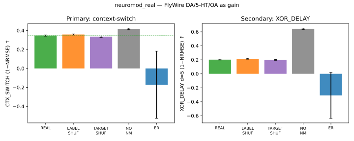

# RESULTS — Real brain chemicals (neuromod_real)

Prereg: `PREREG_neuromod_real.md` (locked 2026-10-29 08:08 America/New_York, before eval).
Rows kept: 600. Eval seeds: 1000–1023 (n=24).

## Neurotransmitter source

- FlyWire annotations `ann.tsv` (`top_nt`), repo https://github.com/flyconnectome/flywire_annotations commit `1a83b2776d60d5764cef36b927f5f9679c16c47a2`.
- Method: FlyWire Codex ML-predicted primary neurotransmitter per neuron (Eckstein et al. 2024; columns top_nt, top_nt_conf)
- CX counts: `{'ACh': 1697, 'GABA': 336, 'Glu': 632, 'DA': 61, '5HT': 147, 'OA': 1, 'UNK': 1}` → **n_mod = 209** (DA+5-HT+OA).

## Locked α / γ (tune seeds 90–92, maximize CTX_SWITCH)

| Arm | α | γ | tune CTX mean |
|---|---:|---:|---:|
| `NM_REAL` | 1e-06 | 0.25 | 0.3406 |
| `NM_LABEL_SHUF` | 1e-06 | 0.25 | 0.3229 |
| `NM_TARGET_SHUF` | 1e-06 | 0.25 | 0.3317 |
| `NO_NM` | 1e-08 | 0.0 | 0.4078 |
| `NM_ER` | 0.1 | 2.0 | 0.3562 |

## Means ± SEM (eval)

| Arm | CTX_SWITCH | XOR_DELAY | NARMA | MC | PC_HARD |
|---|---:|---:|---:|---:|---:|
| `NM_REAL` | 0.347±0.007 | 0.202±0.006 | 0.499±0.008 | 14.885±0.225 | 0.825±0.010 |
| `NM_LABEL_SHUF` | 0.358±0.006 | 0.214±0.006 | 0.496±0.007 | 15.236±0.254 | 0.835±0.010 |
| `NM_TARGET_SHUF` | 0.335±0.007 | 0.198±0.006 | 0.500±0.008 | 14.851±0.222 | 0.830±0.009 |
| `NO_NM` | 0.417±0.009 | 0.643±0.010 | 0.451±0.006 | 17.745±0.246 | 0.779±0.015 |
| `NM_ER` | -0.172±0.355 | -0.309±0.329 | 1.090±0.270 | 10.176±0.853 | 0.866±0.016 |

↑ better: CTX_SWITCH, XOR_DELAY, MC, PC_HARD. ↓ better: NARMA.

## Primary (CTX_SWITCH, one-sided Wilcoxon, Bonferroni ×3)

| Hyp | Contrast | mean_REAL | mean_ctrl | Δ | d_z | p_raw | p_bonf |
|---|---|---:|---:|---:|---:|---:|---:|
| H1 | `NM_REAL` > `NO_NM` | 0.3469 | 0.4169 | -0.0700 | -1.752 | 1 | 1 |
| H2 | `NM_REAL` > `NM_LABEL_SHUF` | 0.3469 | 0.3578 | -0.0109 | -0.302 | 0.8616 | 1 |
| H3 | `NM_REAL` > `NM_ER` | 0.3469 | -0.1719 | 0.5188 | 0.298 | 0.008935 | 0.02681 |

**Primary verdict: NOT SUPPORTED** (1/3 hypotheses pass).

## Secondary (exploratory)

- CTX_SWITCH NM_REAL vs NM_TARGET_SHUF: Δ=0.0115, p_one=0.006302, d_z=0.376

| Task | Contrast | Δ | p_raw (one-sided greater for ↑ tasks; for NARMA: NO_NM/ctrl − REAL style via alt) |
|---|---|---:|---:|
| XOR_DELAY | `NM_REAL` vs `NO_NM` | -0.4409 | 1 |
| XOR_DELAY | `NM_REAL` vs `NM_LABEL_SHUF` | -0.0124 | 0.9995 |
| XOR_DELAY | `NM_REAL` vs `NM_ER` | 0.5112 | 0.658 |
| NARMA | `NM_REAL` vs `NO_NM` | 0.0481 | 1 |
| NARMA | `NM_REAL` vs `NM_LABEL_SHUF` | 0.0033 | 0.9911 |
| NARMA | `NM_REAL` vs `NM_ER` | -0.5902 | 5.96e-08 |
| MC | `NM_REAL` vs `NO_NM` | -2.8593 | 1 |
| MC | `NM_REAL` vs `NM_LABEL_SHUF` | -0.3510 | 0.9971 |
| MC | `NM_REAL` vs `NM_ER` | 4.7091 | 5.96e-08 |
| PC_HARD | `NM_REAL` vs `NO_NM` | 0.0464 | 0.0002472 |
| PC_HARD | `NM_REAL` vs `NM_LABEL_SHUF` | -0.0099 | 0.9925 |
| PC_HARD | `NM_REAL` vs `NM_ER` | -0.0414 | 0.9999 |

## Figure

Also: `figs/neuromod_real.png`.

## Plain words

Turning real dopamine/serotonin/octopamine neurons into a slow gain dial did **not** clearly beat the controls on the context-switch test after correction. Either the chemical map does not help this abstract task, or our simple gain model is too crude. See the table — report the negatives.

## Honesty

- Reservoir gain ≠ biological neuromodulation or fly behavior.
- `top_nt` is ML-predicted chemistry, not wet-lab ground truth for every cell.
- CPU only (N=2875); γ/α locked on 90–92 before eval 1000–1023.

## Runtime

- Tune+eval wall: 2026-10-29 08:11:38 EDT → 2026-10-29 08:25:23 EDT (~13.8 min); WORKERS=2, CPU only (N=2875).
- Competing box load (myelin_mechanism, gated_team, hybrid) slowed wall clock.

